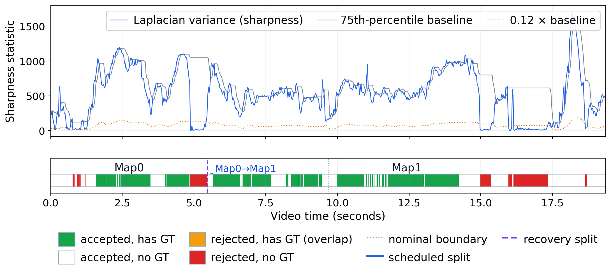
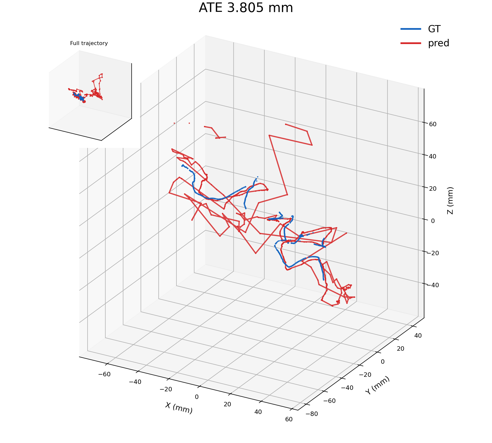
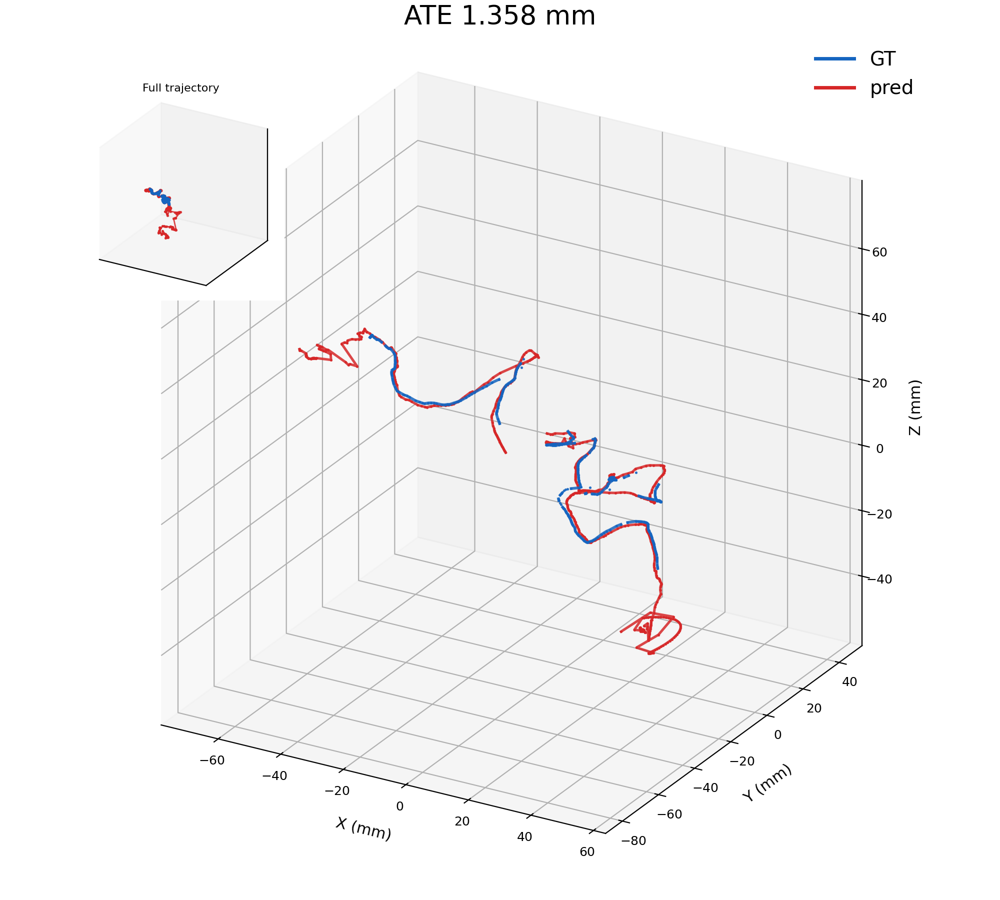

<div id="top" align="center">

# ASD-VO: Adaptive Submap Decomposition for Endoscopic Visual Odometry

[Zhenwei Zhang](https://github.com/Zhangzw-99), [Lituan Wang](https://github.com/LTWangSCU), Ao Wang, Xiangbao Gong

School of Artificial Intelligence, Sichuan University

[](LICENSE) [](https://www.python.org/) [](https://cg.cs.tsinghua.edu.cn/jittor/) [](https://developer.nvidia.com/cuda-toolkit)
</div>

> **PyTorch Version**: [ASD-VO](https://github.com/Zhangzw-99/ASD-VO)

ASD-VO is a robust monocular visual odometry method for colonoscopy videos. It prevents severely degraded frames from contaminating geometric optimization and separates unreliable intervals through adaptive submap decomposition. The method keeps the pretrained [DPVO](https://github.com/princeton-vl/DPVO) network frozen and improves its inference pipeline with degradation-aware frame selection, robust bundle adjustment, motion-based pose recovery, and numerical rollback.

## 🔍 Overview

ASD-VO detects frames with insufficient visual information before they enter the optimization graph. A prolonged degraded interval triggers a new submap when reliable observations recover, preventing errors from spreading across the interval.

<p align="center">
  
</p>

<p align="center"><em>Frame-quality signal, frame decisions, and recovery-triggered submap decomposition.</em></p>

The released pipeline provides:

- degradation-aware frame acceptance and rejection;
- adaptive temporal submaps for long unreliable intervals;
- Huber-weighted bundle adjustment and relative inverse-depth regularization;
- FP32 retry and rollback for unstable numerical states;
- CLiMB-compatible trajectories, sparse point clouds, and runtime output.

## 📊 Example

The following example is from the difficult `Seq_001_a` sequence. Adaptive splitting confines the influence of a degraded interval and reduces ATE from **3.805 mm** to **1.358 mm**.

| Without adaptive splitting | ASD-VO |
|:---:|:---:|
|  |  |
| ATE: 3.805 mm | **ATE: 1.358 mm** |

## 🛠️ Setup

The standalone Jittor environment uses Linux, Python 3.10, Jittor 1.3.11+, CUDA Toolkit 12.4, and cuDNN 8.9.

Install the required system tools on Ubuntu or Debian:

```bash
sudo apt update
sudo apt install -y git wget unzip build-essential
```

Install an NVIDIA driver and Conda before continuing.

```bash
git clone https://github.com/Zhangzw-99/ASD-VO-Jittor.git
cd ASD-VO-Jittor

conda create -n asdvo-jittor python=3.10 pip -y
conda activate asdvo-jittor

conda install -y -c "nvidia/label/cuda-12.4.1" cuda-toolkit=12.4.1
conda install -y -c conda-forge "cudnn=8.9" "cuda-version=12.4"
# Expose Conda's CUDA/cuDNN libraries under $CONDA_PREFIX/lib64 for Jittor compilation
ln -sfn "$CONDA_PREFIX/lib" "$CONDA_PREFIX/lib64"
pip install -r requirements.txt
```

### Pretrained Weights

Jittor loads the official PyTorch `dpvo.pth` checkpoint directly via `jt.load`.

Download and extract the pretrained DPVO weights to `./ckpt/dpvo.pth`:

```bash
mkdir -p ckpt
wget -O models.zip "https://www.dropbox.com/s/nap0u8zslspdwm4/models.zip?dl=1"
unzip -o models.zip -d ckpt
rm -f models.zip
```

If Dropbox is unavailable, download `dpvo.pth` manually from the [official DPVO repository](https://github.com/princeton-vl/DPVO#readme) and place it at `./ckpt/dpvo.pth`.

## 🚀 Inference

Place all input videos in one directory:

```text
input/
├── video_a.mp4
└── video_b.mp4
```

The released calibration expects 4:3 MP4 videos. Other aspect ratios are rejected before inference.

Run ASD-VO from the `ASD-VO-Jittor` directory:

```bash
conda activate asdvo-jittor
bash scripts/run.sh \
  --videos-root /path/to/input \
  --output-root /path/to/output
```

The default command runs five independent seeds for every video using `BACKEND=AUTO` (automatically selecting `CUDA_INLINE` on GPU for best speed, or falling back to `JITTOR` when CUDA is disabled). To test one sequence with one run:

```bash
bash scripts/run.sh \
  --videos-root /path/to/input \
  --output-root /path/to/debug-output \
  --sequences video_a \
  --runs 1
```

Backend options (`--opts BACKEND <VALUE>`):

- `AUTO` (default): uses `CUDA_INLINE` when `jt.flags.use_cuda` is active, falling back to `JITTOR` otherwise.
- `CUDA_INLINE`: forces Jittor inline CUDA (`jt.code`) kernels for `altcorr` and `fastba` (fastest on GPU).
- `JITTOR`: uses native Jittor tensor operations without inline CUDA kernels (useful for fallback or debugging).

## 📁 Output

```text
output/<video>/<run_id>/
├── 3D_maps/<map_id>/points3D.txt
├── camera_trajectory/cam_traj_map_<map_id>.txt
└── runtime.txt
```

Each submap has an independent coordinate system. The trajectory and point cloud with the same map ID share that coordinate system.

Trajectory rows use the following format:

```text
timestamp,name_image,tx,ty,tz,qw,qx,qy,qz
```

## 📂 Repository Structure

```text
.
├── climb/                     # CLiMB submission CLI pipeline
├── configs/asd_vo.yaml        # Released configuration
├── dpvo/                      # Standalone Jittor DPVO implementation
└── scripts/run.sh
```

## ⚡ Benchmark

Comparison between the PyTorch implementation ([ASD-VO](https://github.com/Zhangzw-99/ASD-VO)) and the Jittor backends on four representative CLiMB sequences:

| Sequence | PyTorch <br>(`ATE / score_ate / Time`) | Jittor <br>(`ATE / score_ate / Time`) | Jittor (`CUDA_INLINE`)<br>(`ATE / score_ate / Time`) |
|:---|:---:|:---:|:---:|
| `Seq_001_a` | 1.327 mm / 1.970 / 38.092 s | 1.258 mm / 1.887 / 75.247 s | 1.369 mm / 1.868 / 33.455 s |
| `Seq_001_c` | 0.941 mm / 1.000 / 16.221 s | 0.900 mm / 1.350 / 54.832 s | 0.900 mm / 1.223 / 24.733 s |
| `Seq_003_a` | 0.695 mm / 0.731 / 26.846 s | 0.638 mm / 0.957 / 68.847 s | 0.638 mm / 0.813 / 37.698 s |
| `Seq_003_b` | 2.300 mm / 2.587 / 11.154 s | 1.883 mm / 2.824 / 37.639 s | 1.880 mm / 2.704 / 16.744 s |
| **Mean / Total** | **1.32 mm / 1.572 / 92.31 s** | **1.17 mm / 1.755 / 236.57 s** | **1.20 mm / 1.652 / 112.63 s** |


## 📖 Citation

If you find ASD-VO useful, please cite:

```bibtex
@misc{zhang2026asdvo,
  title  = {ASD-VO: Adaptive Submap Decomposition for Endoscopic Visual Odometry},
  author = {Zhang, Zhenwei and Wang, Lituan and Wang, Ao and Gong, Xiangbao},
  year   = {2026},
  url    = {https://github.com/Zhangzw-99/ASD-VO-Jittor}
}
```

Please also cite the original DPVO and DPV-SLAM papers.

## 🙏 Acknowledgements

ASD-VO is built on [DPVO](https://github.com/princeton-vl/DPVO) and its DPV-SLAM extensions. We thank the authors for releasing their code and pretrained models.

## 📄 License

This project is released under the [MIT License](LICENSE). The modified DPVO files follow the upstream license included in [licenses/DPVO-LICENSE](licenses/DPVO-LICENSE).
